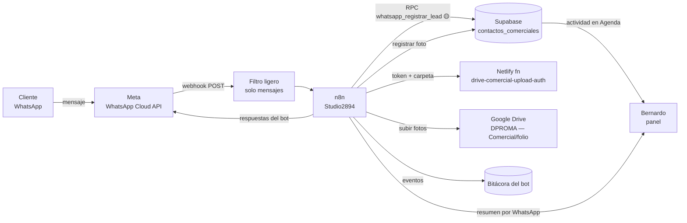

# 01 · Arquitectura

> Borrador v0.3 · 02/11/2026. Basado en una revisión **de solo lectura** del panel
> (`panel.dproma.com`): sesión de prueba de Comercial y lectura del JavaScript público. No se
> guardó ni modificó nada. Lo marcado **🟡** es una propuesta que Félix tiene que validar
> (`03-plantilla-relevamiento.md`, sección A). El Cotizador está fuera de alcance (§10).

## 1. Panel actual

| Pieza | Qué es | Cómo la usa la PoC |
|---|---|---|
| **Supabase** (`pguddleutaztxgihvpas`) | Auth, base de datos Postgres expuesta por PostgREST, RPCs y RLS por rol | Destino de los leads |
| **Netlify** | Hospeda el panel (HTML/JS estático) y sus funciones (`/.netlify/functions/*`) | Función de Drive ya existente |
| `contactos_comerciales` | Fichas de Comercial. Campos: `folio`, `nombre`, `telefono`, `telefono_norm`, `correo`, `vehiculo`, `domicilio`, `estado_id`, `observaciones_texto`, `origen` (`directa` / `oem`). Etapa `lead → prospecto → cliente` calculada por la BD; estado `activo` / `perdido` | **Aquí se crea el lead del bot** |
| `comercial_evidencias` + función `drive-comercial-upload-auth` | Imágenes de la ficha en Google Drive, carpeta `DPROMA — Comercial/{folio}`; la función entrega token y carpeta, y la fila solo referencia el archivo | **Aquí van las fotos del bot** |
| `comercial_actividades` (Agenda) | Pendientes de cada vendedor | **Aviso a Bernardo dentro del panel** |
| RPC `prospecto_duplicados` + `telefono_norm` | Detección de teléfono repetido en fichas y prospectos de ICEV | Evitar fichas duplicadas |
| `cotizaciones` (ligadas por `contacto_id`) | El Cotizador | Fuera de alcance; el bot solo junta los datos que pide (§10) |
| `comercial_formalizar`, `comercial_pasar_a_icev`, `prospectos` | Lo que pasa después: cotización aceptada → ICEV | Sin cambios |

**Conclusión:** no hace falta crear un CRM ni una bóveda de fotos. El bot crea una ficha
`lead` en Contactos, igual que cuando Bernardo usa "Nuevo lead", pero sin captura manual.

## 2. Componentes



| Pieza | Responsable | Decisión |
|---|---|---|
| Número de WhatsApp | Félix / Dirección | Número **nuevo y dedicado** en Cloud API (§8) |
| Proveedor de WhatsApp | — | **Meta Cloud API directa**, sin BSP (§7) |
| Orquestador | **Studio2894** | **n8n**: conversación, validación, reintentos, llamadas al panel |
| Entrada al panel | Félix | RPC `whatsapp_registrar_lead` + usuario de servicio 🟡 (§3) |
| Fotos | Félix (ya existe) | Función `drive-comercial-upload-auth` + `comercial_evidencias` |
| Aviso | Félix (ya existe) | Actividad en `comercial_actividades` + WhatsApp a Bernardo |

## 3. Entrada al panel (propuesta)

**Lo que no se debe hacer:** que n8n use la cuenta `comercial@dproma.com` o la llave
`service_role` de Supabase. La primera mezcla al bot con una persona; la segunda se salta
todo el RLS.

**Propuesta:**

1. **Usuario de servicio** `bot-whatsapp@dproma.com` en Supabase Auth, con un rol propio
   (por ejemplo `BotWhatsApp`) que no ve el panel y solo puede ejecutar las RPCs del bot.
   n8n inicia sesión con él (`/auth/v1/token`) y renueva el token. Así `created_by` queda
   atribuido al bot.
2. **RPC `whatsapp_registrar_lead`** (SECURITY DEFINER, `GRANT EXECUTE` solo a ese rol). Hace
   todo en una transacción:
   - busca por `telefono_norm`: si ya hay una ficha **activa**, la actualiza y agrega una
     observación; si no, inserta una nueva con etapa `lead`;
   - guarda los campos del bot (§9);
   - asigna como responsable a Bernardo (o al vendedor que diga la regla);
   - crea una actividad en `comercial_actividades`: "Contactar lead de WhatsApp", con fecha de
     hoy;
   - devuelve `{ id, folio, nuevo: true|false }`.
3. **RPC `whatsapp_registrar_evidencia`** (o un insert permitido por RLS) para registrar cada
   foto en `comercial_evidencias` después de subirla.
4. **Fotos:** n8n llama a `drive-comercial-upload-auth` con el token del bot y el
   `contacto_id`, recibe `{ accessToken, folderId }`, sube a Drive por multipart y registra
   el archivo. Es el mismo mecanismo que usa `contactos-imagenes.js`. 🟡 Confirmar que la
   función acepta al rol del bot.

**Por qué una RPC y no inserts sueltos:** la lógica de duplicados, la asignación y el aviso
viven en un solo lugar, dentro del sistema de Félix, y n8n no necesita conocer la estructura
interna de las tablas.

## 4. Webhook de Meta

Meta llama a **una sola URL** con dos tipos de petición:

1. **Verificación (GET, una vez).** Meta manda `hub.mode=subscribe`, `hub.verify_token` y
   `hub.challenge`; se compara el token y se responde el `hub.challenge` con código 200.
2. **Eventos (POST).** En `entry[].changes[].value` llegan:
   - `messages[]`: lo que escribió el cliente (`text`, `interactive`, `location`, `image`,
     `document`, `audio`, `video`);
   - `contacts[]`: `wa_id` y `profile.name`;
   - `statuses[]`: confirmaciones de los mensajes enviados.

**Reglas del nodo de entrada:**

- **Validar la firma** `X-Hub-Signature-256` (HMAC-SHA256 con el *App Secret*).
- **Responder 200 de inmediato** y procesar aparte; si no, Meta reintenta y llegan duplicados.
- **Evitar duplicados** con `messages[].id` (`wamid`).
- **Filtro de avisos de estado:** cada mensaje del bot genera unos 3 avisos (enviado,
  entregado, leído). Una función ligera delante de n8n, que puede ser otra Netlify Function del
  mismo sitio, reenvía solo `messages[]` y los `failed`. Así las ejecuciones cobradas bajan
  unas 4 veces (`04-costos-y-kpis.md`).

Ejemplo de payload y del lead resultante: `schema/poc-whatsapp-ejemplo.json`.

## 5. Estados de la conversación

El estado de cada `wa_id` lo guarda n8n (tabla de datos de n8n o tabla `whatsapp_conversaciones`
en Supabase 🟡).

```
NUEVO → NOMBRE → INMUEBLE → VEHICULO → DOMICILIO → METROS → MEDIDOR → FOTOS → COMPLETO
                   │                                                            │
                   └── flotilla / "asesor" / 2 respuestas no válidas ──────────► HUMANO
                                                                                │
                     COMPLETO o HUMANO → whatsapp_registrar_lead → fotos → aviso a Bernardo
```

- La ficha se crea **al terminar** (o al pasar a una persona), no con el primer mensaje. Así
  no se llena Contactos de fichas vacías. Si el cliente abandona, a las 23 h se registra con
  lo que haya y la observación "datos incompletos".
- Si vuelve a escribir después de `COMPLETO`, el mensaje se agrega como observación de la
  ficha y Bernardo recibe el aviso.
- Sin respuesta en 30 min: un recordatorio, solo uno.
- Guion completo: `02-flujo-conversacional.md`.

## 6. Errores

| Falla | Qué hace n8n | Evento |
|---|---|---|
| La RPC falla o Supabase no responde | 3 reintentos (1, 5, 15 min); después, cola de fallidos, aviso a Félix y el resumen igual le llega a Bernardo por WhatsApp | `error_crm` |
| Token del bot vencido | Renueva la sesión y reintenta una vez | `error_auth` |
| Error al subir una foto | Reintento; si falla, observación "fotos pendientes" en la ficha | `error_media` |
| Falla el aviso por WhatsApp a Bernardo | Queda la actividad en la Agenda; reintento por correo | `error_aviso` |
| Mensaje enviado con `status=failed` | Se guarda el código de error de Meta | `error_envio` |
| Respuesta que el bot no entiende | Repite la pregunta; a la segunda, pasa a una persona | `no_reconocido` |

**Ventana de 24 h:** el bot siempre contesta dentro de la ventana, así que no necesita
plantillas de Meta. Lo que Bernardo responda después lo hace desde su flujo habitual.

## 7. Stack

- **Orquestador: n8n** (decidido). Para la PoC, n8n Cloud Starter; si se valida, el mismo
  flujo en n8n *self-hosted*. Studio2894 lo opera y cambia el guion sin depender de un
  despliegue del panel. Lo único que Félix expone es la RPC y el usuario de servicio.
- **Cloud API directa, sin BSP:** volumen bajo, nodos nativos en n8n y sin margen por mensaje.
  Requisitos: cuenta de Meta Business (idealmente verificada), app en Meta for Developers con
  WhatsApp, usuario de sistema con token permanente y el número dado de alta.

## 8. Riesgos

| Riesgo | Detalle | Mitigación |
|---|---|---|
| **Número de Bernardo** | Pasarlo a la Cloud API lo saca de la app normal, salvo con *coexistencia*, que tiene límites | PoC con **número nuevo**; evaluar coexistencia después |
| **Datos personales (LFPDPPP)** | Se piden nombre, domicilio y fotos de la casa | Enlace al aviso de privacidad en el primer mensaje; publicarlo antes de salir |
| **Credenciales** | Durante esta revisión se compartió por chat la contraseña de una cuenta de prueba | No guardarla en el repo; **cambiarla** al terminar la revisión; el bot usa su propio usuario |
| **Fichas duplicadas** | Un cliente que ya escribió a Bernardo o que viene de una agencia ya registrada | La RPC deduplica por `telefono_norm` y actualiza en vez de crear |
| **Abandono del bot** | 6 preguntas + fotos | Preguntas de un toque, saltar el vehículo si viene de agencia, fotos opcionales, medir el abandono por paso |
| **Verificación de Meta** | Límites de mensajes sin verificación | Iniciarla en cuanto se apruebe la PoC |

## 9. Mapeo de campos

| Dato del bot | Campo del panel | Estado |
|---|---|---|
| `nombre` | `nombre` | ✅ existe |
| `telefono` (E.164 desde `wa_id`) | `telefono` (la BD calcula `telefono_norm`) | ✅ existe |
| `vehiculo` (marca + modelo) | `vehiculo` | ✅ existe |
| `domicilio` (texto) | `domicilio` | ✅ existe |
| Estado de la república (a partir del CP) | `estado_id` | ✅ existe; n8n traduce CP → estado con el catálogo `estados` 🟡 |
| `origen` | `origen`: `oem` si vino de agencia, `directa` en otro caso | ✅ existe |
| Nombre de la agencia (`agencia:changan-del-valle`) | — | 🟡 columna nueva `agencia` (ya existe en `prospectos`) |
| Canal (`whatsapp`) | — | 🟡 columna nueva `canal` (hoy no se distingue WhatsApp de captura manual) |
| `tipo_inmueble` (`Casa particular` / `Residencial` / empresa) | — | 🟡 columna nueva (ya existe en `cotizaciones`, mismos valores) |
| `metros_aprox` (`hasta_10` / `11_20` / `21_30` / `mas_30` / `no_se`) | — | 🟡 columna nueva |
| `medidor_independiente` (`si` / `no` / `no_se`) | — | 🟡 columna nueva |
| Resumen legible de todo lo anterior | `observaciones_texto` | ✅ existe; **plan B** si no se agregan columnas |
| Fotos | `comercial_evidencias` + Drive | ✅ existe |
| Responsable | (responsable de la ficha) | ✅ existe; regla: Bernardo 🟡 |
| `wa_id`, eventos, `wamid` | — | 🟡 tabla `whatsapp_eventos` (o bitácora en n8n) |

**Mínimo para arrancar:** con solo la RPC y `observaciones_texto` como plan B, la PoC funciona
sin tocar el esquema. Las columnas nuevas (`agencia`, `canal`, `tipo_inmueble`,
`metros_aprox`, `medidor_independiente`) permiten filtrar y medir en el panel, y son las que
el Cotizador va a querer leer.

## 10. Cotizador

El bot **no crea cotizaciones**. El cotizador del panel se usó solo para decidir **qué datos
pedir**, de modo que Bernardo abra la ficha y cotice sin volver a preguntar:

| Concepto o campo del cotizador | Dato que lo alimenta |
|---|---|
| Cliente, Domicilio, Vehículo, Tipo de inmueble | `nombre`, `domicilio`, `vehiculo`, `tipo_inmueble` |
| 1 · Instalación estándar (incluye 10 m) | `metros_aprox` = `hasta_10` |
| 3 · Metro excedente desde el 11 ($450/m) | `metros_aprox` |
| 2 · Trámite CFE / medidor independiente | `medidor_independiente` |
| 5 · Mufa (acometida del nuevo medidor) | `medidor_independiente` + foto del medidor |
| 4 · Tierra física, consideraciones de tablero, muro y andamio | Fotos del tablero y del recorrido |

Cuando el Cotizador evolucione, podrá leer estos campos desde la ficha (`contacto_id`) sin
cambios en el bot.
