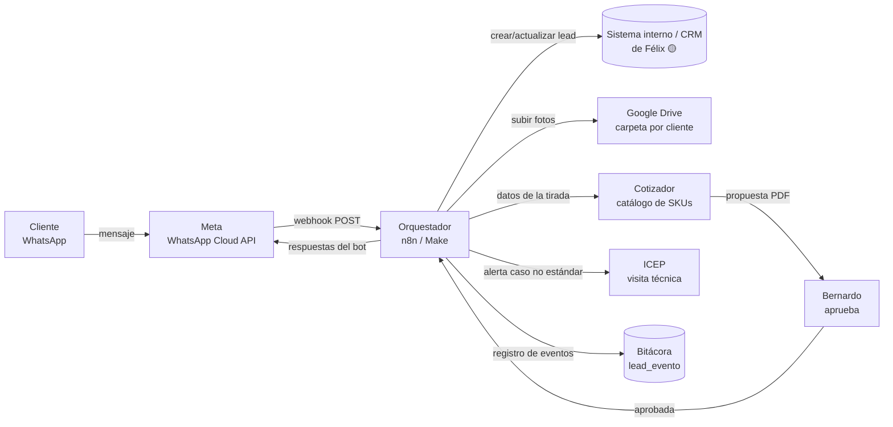

# 01 · Arquitectura de integración (borrador)

> Borrador v0.1 · 31/10/2026. Lo marcado **🟡 por confirmar** depende del relevamiento con
> Félix (`03-plantilla-relevamiento.md`, sección A).

## 1. Componentes



| Pieza | Qué hace | Opción para la PoC |
|---|---|---|
| Número de WhatsApp | Recibe a los prospectos | Número **nuevo y dedicado** ("DPROMA Cargadores") en Cloud API. Ver §9 sobre coexistencia con el número de Bernardo. |
| Proveedor de WhatsApp | Envía y recibe mensajes | **Meta Cloud API directa** (sin intermediario; ver §8) |
| Orquestador | Lógica del bot, mapeo de datos, llamadas a CRM/Drive/cotizador | **n8n** (ver §8) |
| Estado de la conversación | Recordar en qué paso va cada cliente | Tabla `conversacion` en la BD del orquestador o del CRM 🟡 |
| CRM / sistema interno | Oportunidad comercial y tablero | Sistema de Félix 🟡 |
| Bóveda de evidencias | Fotos del tablero, acometida, sitio | Google Drive, una carpeta por lead |
| Cotizador | Calcula la propuesta estándar | Catálogo de SKUs de Almacén (Nacho) 🟡 |

## 2. Webhook de Meta

Meta llama a **una sola URL** del orquestador con dos tipos de petición:

1. **Verificación (GET, una vez al configurarlo).** Meta manda `hub.mode=subscribe`,
   `hub.verify_token` y `hub.challenge`. El orquestador compara el token con uno secreto y
   responde el `hub.challenge` tal cual, con código 200.
2. **Eventos (POST).** Cada mensaje entrante y cada cambio de estado (enviado, entregado,
   leído, fallido) llega en `entry[].changes[].value`:
   - `messages[]`: lo que escribió el cliente (`text`, `interactive` con la respuesta del botón
     o lista, `location`, `image`, `document`, `audio`, `video`).
   - `contacts[]`: `wa_id` (teléfono) y `profile.name` (nombre del perfil).
   - `statuses[]`: confirmaciones de los mensajes que mandamos; sirven para medir errores.

**Reglas obligatorias del nodo de entrada:**

- **Validar la firma** `X-Hub-Signature-256` (HMAC-SHA256 del cuerpo con el *App Secret*).
  Si no coincide, se descarta.
- **Responder 200 de inmediato** y procesar aparte. Si tarda o falla, Meta reintenta y llegan
  duplicados.
- **Evitar duplicados**: guardar el `messages[].id` (`wamid`) y no procesar dos veces el mismo.
- Ignorar `statuses[]` en el flujo del bot, pero guardar los `failed` en la bitácora.

Ejemplo completo de payload y del lead resultante: `schema/poc-whatsapp-ejemplo.json`.

## 3. Máquina de estados de la conversación

Cada número (`wa_id`) tiene un estado. El orquestador lee el estado, interpreta el mensaje,
guarda el dato y avanza.

```
NUEVO → NOMBRE → INMUEBLE → AUTO → UBICACION → DISTANCIA → FOTOS → COMPLETO
                   │                                                     │
                   └── flotilla / "asesor" / 2 respuestas no válidas ──► HUMANO
                                                                         │
                                       COMPLETO → ESTANDAR | NO_ESTANDAR
```

- Si el cliente vuelve a escribir después de `COMPLETO`, el mensaje se adjunta al lead como
  nota y se avisa a Bernardo; el bot no vuelve a empezar.
- Sin respuesta en 30 min: un recordatorio. Sin respuesta en 23 h: el lead queda
  `INCOMPLETO` con lo que haya y pasa a Bernardo (antes de que cierre la ventana de 24 h).
- Guion y textos de cada estado: `02-flujo-conversacional.md`.

## 4. Fotos y documentos (bóveda de evidencias)

1. Llega `image`/`document` con un `id` de media.
2. `GET https://graph.facebook.com/v{n}/{media-id}` con el token → devuelve una `url`
   **temporal** (caduca en minutos) y el `mime_type`.
3. Descargar de esa `url` con el mismo token **en ese momento**.
4. Subir a Drive: `Leads WhatsApp / {AAAA-MM} / {lead_id} - {nombre} /`, con nombre
   `{tipo}-{n}.jpg` (`tablero`, `acometida`, `sitio`, `otro`).
5. Guardar en `lead_evidencia` el enlace de Drive y el tipo.

El tipo de foto se deduce del paso en que la mandó (el bot las pide de una en una). Si manda
un audio, video o archivo raro, se guarda en la carpeta y el lead se marca para revisión
humana.

**Plan B:** si el cliente no puede mandar fotos en el momento, el bot le manda un enlace a un
formulario de carga (Google Forms con subida de archivos o una página del sistema de Félix 🟡)
ligado a su `lead_id`.

## 5. Origen del lead (atribución)

Un enlace `wa.me` con mensaje precargado por canal; el orquestador reconoce el texto inicial:

| Canal | Enlace | Texto precargado → `origen` |
|---|---|---|
| Changan del Valle | `https://wa.me/52XXXXXXXXXX?text=Hola%2C%20vengo%20de%20Changan%20del%20Valle` | `agencia:changan-del-valle` |
| Otra agencia | igual, con su nombre | `agencia:{slug}` |
| Sitio web | `...?text=Hola%2C%20vi%20su%20p%C3%A1gina` | `web` |
| Sin texto reconocido | — | `directo` |

Se puede imprimir como **código QR** para el piso de venta de cada agencia. Si viene de una
agencia, el bot ya sabe la marca y se salta la pregunta del auto (ver flujo).

## 6. Clasificación estándar / no estándar

Reglas fijas, sin IA, para que sean auditables:

| Condición | Resultado |
|---|---|
| Inmueble = casa **y** distancia = "hasta 10 m" **y** hay al menos foto del tablero | `ESTANDAR` |
| Distancia = "más de 10 m" **o** "no sé" | `NO_ESTANDAR` |
| Inmueble = empresa / flotilla / otro | `NO_ESTANDAR` (y pasa a Bernardo) |
| Sin fotos | `ESTANDAR_PENDIENTE_FOTOS`: se cotiza, pero Bernardo confirma antes de enviar |

**Estándar →** el orquestador manda al cotizador `{inmueble, auto, distancia_m, ubicacion}` y
recibe la propuesta. **En la PoC, Bernardo aprueba con un clic** (botón en WhatsApp o en el
tablero) antes de que salga al cliente. Meta para el SLA: menos de 2 h desde `datos_completos`
hasta `cotizacion_enviada`.

**No estándar →** alerta a ICEP (Mauricio CR / Jhonatan Álvarez) con el enlace a la carpeta de
fotos y la ubicación; ICEP propone fecha de visita; el bot se la confirma al cliente. Los
tiempos de cada paso salen del diagrama acordado por dirección (Nicole / Diana) 🟡.

**Lógica del cotizador (supuesto para validar con Nacho 🟡):**

```
total = kit_base(modelo de cargador)
      + metros × (cable THW cal. 6 + tubería) por metro
      + centro de carga 2 polos + interruptor termomagnético + caja NEMA
      + mano de obra(estándar)
```

Los precios se leen del catálogo central de SKUs que mantiene Nacho; nadie del equipo
comercial los busca a mano.

## 7. Manejo de errores

| Falla | Qué hace el sistema | Se registra como |
|---|---|---|
| CRM no responde o da error | 3 reintentos (1 min, 5 min, 15 min); si sigue fallando, cola de fallidos y aviso a Félix | `error_crm` |
| Error al descargar o subir una foto | Reintento; si falla, el lead queda con "fotos pendientes" | `error_media` |
| Cotizador falla | El lead pasa a Bernardo para cotizar a mano | `error_cotizador` |
| Mensaje enviado con `status=failed` | Se guarda el código de error de Meta | `error_envio` |
| Mensaje que el bot no entiende | Repite la pregunta; a la segunda, pasa a una persona | `no_reconocido` |
| Cliente escribe fuera de horario | El bot captura igual; avisa en qué horario lo contactan | — |

**Ventana de 24 h:** dentro de las 24 h desde el último mensaje del cliente se puede contestar
con texto libre. Fuera de esa ventana **solo se pueden mandar plantillas aprobadas por Meta**.
Por eso la propuesta, la confirmación de visita tardía y la encuesta posventa necesitan
plantilla (§10).

La tasa de error de la PoC es `eventos de error / mensajes procesados` (ver `04-costos-y-kpis.md`).

## 8. Decisiones de stack (recomendación)

### Make vs n8n

| | Make | n8n |
|---|---|---|
| Arranque | Inmediato, en la nube | Nube (n8n Cloud) inmediato; *self-hosted* requiere servidor |
| Costo | Por créditos (≈ 1 crédito por módulo ejecutado); sube con el volumen | Cloud por ejecuciones; *self-hosted* Community gratis (solo servidor) |
| Datos de clientes | En servidores de Make | *Self-hosted*: en la infraestructura de DPROMA |
| Lógica de estados y código | Posible pero incómoda | Nodos de código (JS) y BD nativos |
| Migrar de nube a propio | Hay que rehacer todo en otra herramienta | El mismo flujo se exporta e importa |

**Recomendación:** **n8n Cloud (Starter) para la PoC** y, si se valida, pasar el mismo flujo
a **n8n *self-hosted* en la infraestructura de Félix**. Así no hay que montar servidor para
probar, y no se rehace nada al escalar. Si Félix ya tiene experiencia sólida con Make y no con
n8n, Make es aceptable para la PoC, sabiendo que escalar implica rehacer. → Se decide con la
respuesta de Félix (relevamiento A.7).

### Cloud API directa vs BSP (Twilio, Wati, 360dialog…)

**Recomendación: Cloud API directa.** El volumen de la PoC es bajo, n8n y Make tienen nodos
nativos de WhatsApp Cloud API, y un BSP añade suscripción o margen por mensaje sin resolver
nada que la PoC necesite. Un BSP tendría sentido si DPROMA quisiera una bandeja compartida para
varios asesores sin construirla (en ese caso, evaluar una herramienta tipo bandeja que no cobre
margen por mensaje).

Requisitos para la Cloud API: cuenta de Meta Business (ideal verificada), una app en Meta for
Developers con el producto WhatsApp, un usuario de sistema con **token permanente**, y el
número dado de alta. 🟡 ¿Quién administra la cuenta de Meta Business de DPROMA?

## 9. Riesgos y puntos de atención

| Riesgo | Detalle | Mitigación |
|---|---|---|
| **Número de Bernardo** | Si se mueve su número a la Cloud API, deja de funcionar en la app normal (salvo *coexistencia*). La coexistencia (app Business + API en el mismo número) está disponible en México, pero tiene límites (grupos, listas de difusión, etc., según la documentación vigente de Meta). | PoC con **número nuevo** dedicado; Bernardo sigue con su WhatsApp y los nuevos leads entran por el número del bot. Evaluar coexistencia después. |
| **Datos personales** | La LFPDPPP exige informar el aviso de privacidad antes o al recabar datos (nombre, domicilio, fotos de la casa). | El primer mensaje incluye enlace al aviso de privacidad. Jurídico debe publicarlo. |
| **Verificación de Meta** | Sin verificación del negocio hay límites de mensajes y de número de teléfonos. | Iniciar la verificación en cuanto se decida el stack. |
| **Precios de material cambian** | Una cotización automática con precios viejos es peor que una manual. | El cotizador lee el catálogo central; cada SKU guarda su fecha de actualización y se bloquea la cotización si un precio tiene más de N días 🟡. |
| **Abandono del bot** | Cada pregunta extra pierde gente. | Preguntas de un toque, saltar la marca si viene de agencia, fotos opcionales; medir abandono por paso. |
| **Campañas con picos** | La campaña de 200+ mensajes se perdió por falta de atención. | El bot responde siempre; los picos se miden y se priorizan por tipo. |

## 10. Plantillas de Meta necesarias

| Plantilla | Categoría probable | Cuándo |
|---|---|---|
| `propuesta_lista` | Utilidad | Enviar la cotización si ya pasaron 24 h |
| `visita_confirmada` / `recordatorio_visita` | Utilidad | Confirmar o recordar la visita de ICEP |
| `encuesta_posventa_15d` | Utilidad | CSAT/NPS sobre la instalación hecha |
| `referidos_posventa` | **Marketing** | Pedir referencias o segunda instalación |

Meta decide la categoría al aprobar la plantilla; pedir referencias o promover otra compra se
considera marketing y cuesta más (ver `04-costos-y-kpis.md`).

## 11. Modelo de datos mínimo

Contrato JSON del lead: `schema/poc-whatsapp-lead.schema.json`. Tablas:

| Tabla | Campos clave | Para qué |
|---|---|---|
| `lead` | `id`, `wa_id`, `telefono`, `nombre`, `origen`, `tipo_inmueble`, `marca_auto`, `modelo_auto`, `ubicacion` (lat/long, dirección, CP), `distancia` (`hasta_10m` / `mas_10m` / `no_se`), `clasificacion`, `estado`, `carpeta_drive_url`, `crm_id` | La oportunidad |
| `lead_evento` | `lead_id`, `tipo`, `ocurrido_en`, `detalle` | Marcas de tiempo para SLA y errores |
| `lead_evidencia` | `lead_id`, `tipo_foto`, `drive_url`, `mime_type`, `wa_media_id` | Fotos y archivos |
| `cotizacion` | `lead_id`, `partidas[]` (SKU, cantidad, precio), `total`, `aprobada_por`, `enviada_en` | Propuesta |
| `conversacion` | `wa_id`, `estado`, `intentos_fallidos`, `ultimo_mensaje_en` | Estado del bot |

Eventos (`lead_evento.tipo`): `primer_mensaje`, `datos_completos`, `clasificado`,
`derivado_humano`, `cotizacion_generada`, `cotizacion_aprobada`, `cotizacion_enviada`,
`alerta_icep`, `visita_agendada`, `visita_realizada`, `instalacion_realizada`,
`encuesta_enviada`, `encuesta_respondida`, y los `error_*`.

### Mapeo hacia el CRM 🟡

| Campo del lead | Campo en el sistema de Félix |
|---|---|
| `nombre` | 🟡 |
| `telefono` | 🟡 |
| `origen` | 🟡 (¿existe "fuente" / "canal"?) |
| `tipo_inmueble`, `marca_auto`, `modelo_auto` | 🟡 |
| `ubicacion` | 🟡 |
| `clasificacion`, `estado` | 🟡 (¿etapas del tablero comercial?) |
| `carpeta_drive_url` | 🟡 |
| marcas de tiempo | 🟡 (¿las guarda el CRM o la bitácora del orquestador?) |

**Esta tabla se completa con la respuesta de Félix** (pendiente #1 del README).
