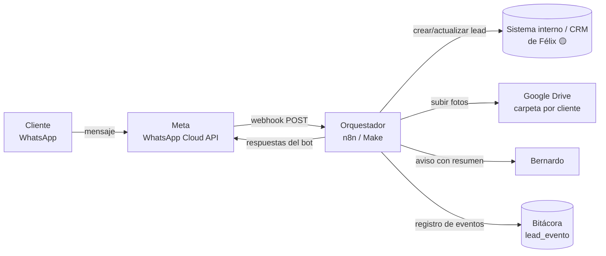

# 01 · Arquitectura de integración (borrador)

> Borrador v0.2 · 31/10/2026. Lo marcado **🟡 por confirmar** depende del relevamiento con
> Félix (`03-plantilla-relevamiento.md`, sección A). El Cotizador está fuera de alcance; ver
> §10.

## 1. Componentes



| Pieza | Qué hace | Opción para la PoC |
|---|---|---|
| Número de WhatsApp | Recibe a los prospectos | Número **nuevo y dedicado** ("DPROMA Cargadores") en Cloud API. Ver §8 sobre coexistencia con el número de Bernardo. |
| Proveedor de WhatsApp | Envía y recibe mensajes | **Meta Cloud API directa** (sin intermediario; ver §7) |
| Orquestador | Lógica del bot, mapeo de datos, llamadas al CRM y a Drive | **n8n** (ver §7) |
| Estado de la conversación | Recordar en qué paso va cada cliente | Tabla `conversacion` en la BD del orquestador o del CRM 🟡 |
| CRM / sistema interno | Guarda la oportunidad comercial | Sistema de Félix 🟡 |
| Bóveda de evidencias | Fotos del tablero, la acometida y el sitio | Google Drive, una carpeta por lead |
| Aviso a Bernardo | Le llega el lead completo | WhatsApp a su número, correo o notificación del CRM 🟡 |

## 2. Webhook de Meta

Meta llama a **una sola URL** del orquestador con dos tipos de petición:

1. **Verificación (GET, una vez al configurarlo).** Meta manda `hub.mode=subscribe`,
   `hub.verify_token` y `hub.challenge`. El orquestador compara el token con uno secreto y
   responde el `hub.challenge` tal cual, con código 200.
2. **Eventos (POST).** Cada mensaje entrante y cada cambio de estado (enviado, entregado,
   leído, fallido) llega en `entry[].changes[].value`:
   - `messages[]`: lo que escribió el cliente (`text`, `interactive` con la respuesta del botón
     o lista, `location`, `image`, `document`, `audio`, `video`).
   - `contacts[]`: `wa_id` (teléfono) y `profile.name` (nombre del perfil).
   - `statuses[]`: confirmaciones de los mensajes que mandamos; sirven para medir errores.

**Reglas obligatorias del nodo de entrada:**

- **Validar la firma** `X-Hub-Signature-256` (HMAC-SHA256 del cuerpo con el *App Secret*).
  Si no coincide, se descarta.
- **Responder 200 de inmediato** y procesar aparte. Si tarda o falla, Meta reintenta y llegan
  duplicados.
- **Evitar duplicados**: guardar el `messages[].id` (`wamid`) y no procesar dos veces el mismo.
- Ignorar `statuses[]` en el flujo del bot, pero guardar los `failed` en la bitácora.
- **Filtro de avisos de estado** (recomendado): cada mensaje del bot genera unos 3 avisos
  (enviado, entregado, leído). Una función ligera delante del orquestador que reenvíe solo
  `messages[]` y los `failed` reduce las ejecuciones cobradas unas 4 veces (ver
  `04-costos-y-kpis.md`).

Ejemplo completo de payload y del lead resultante: `schema/poc-whatsapp-ejemplo.json`.

## 3. Máquina de estados de la conversación

Cada número (`wa_id`) tiene un estado. El orquestador lee el estado, interpreta el mensaje,
guarda el dato y avanza.

```
NUEVO → NOMBRE → INMUEBLE → AUTO → UBICACION → DISTANCIA → FOTOS → COMPLETO
                   │                                                  │
                   └── flotilla / "asesor" / 2 respuestas no válidas ─► HUMANO
                                                                      │
                                       COMPLETO o HUMANO → lead en CRM + aviso a Bernardo
```

- Si el cliente vuelve a escribir después de `COMPLETO`, el mensaje se adjunta al lead como
  nota y se avisa a Bernardo; el bot no vuelve a empezar.
- Sin respuesta en 30 min: un recordatorio. Sin respuesta en 23 h: el lead queda
  `INCOMPLETO` con lo que haya y pasa a Bernardo, antes de que cierre la ventana de 24 h.
- Guion y textos de cada estado: `02-flujo-conversacional.md`.

## 4. Fotos y documentos (bóveda de evidencias)

1. Llega `image`/`document` con un `id` de media.
2. `GET https://graph.facebook.com/v{n}/{media-id}` con el token → devuelve una `url`
   **temporal** (caduca en minutos) y el `mime_type`.
3. Descargar de esa `url` con el mismo token **en ese momento**.
4. Subir a Drive: `Leads WhatsApp / {AAAA-MM} / {lead_id} - {nombre} /`, con nombre
   `{tipo}-{n}.jpg` (`tablero`, `acometida`, `sitio`, `otro`).
5. Guardar en `lead_evidencia` el enlace de Drive y el tipo.

El tipo de foto se deduce del paso en que la mandó, porque el bot las pide de una en una. Si
manda un audio, video o archivo raro, se guarda en la carpeta y el lead se marca para revisión
humana.

**Plan B:** si el cliente no puede mandar fotos en ese momento, el bot le manda un enlace a un
formulario de carga (Google Forms con subida de archivos o una página del sistema de Félix 🟡)
ligado a su `lead_id`.

## 5. Origen del lead (atribución)

Un enlace `wa.me` con mensaje precargado por canal; el orquestador reconoce el texto inicial:

| Canal | Enlace | Texto precargado → `origen` |
|---|---|---|
| Changan del Valle | `https://wa.me/52XXXXXXXXXX?text=Hola%2C%20vengo%20de%20Changan%20del%20Valle` | `agencia:changan-del-valle` |
| Otra agencia | igual, con su nombre | `agencia:{slug}` |
| Sitio web | `...?text=Hola%2C%20vi%20su%20p%C3%A1gina` | `web` |
| Sin texto reconocido | — | `directo` |

Se puede imprimir como **código QR** para el piso de venta de cada agencia. Si viene de una
agencia, el bot ya sabe la marca y se salta la pregunta del auto.

## 6. Manejo de errores

| Falla | Qué hace el sistema | Se registra como |
|---|---|---|
| CRM no responde o da error | 3 reintentos (1 min, 5 min, 15 min); si sigue fallando, cola de fallidos, aviso a Félix y el resumen igual le llega a Bernardo | `error_crm` |
| Error al descargar o subir una foto | Reintento; si falla, el lead queda con "fotos pendientes" | `error_media` |
| Falla el aviso a Bernardo | Reintento por un canal alterno (correo) | `error_aviso` |
| Mensaje enviado con `status=failed` | Se guarda el código de error de Meta | `error_envio` |
| Mensaje que el bot no entiende | Repite la pregunta; a la segunda, pasa a una persona | `no_reconocido` |
| Cliente escribe fuera de horario | El bot captura igual y avisa en qué horario lo contactan | — |

**Ventana de 24 h:** dentro de las 24 h desde el último mensaje del cliente se puede contestar
con texto libre. Fuera de esa ventana **solo se pueden mandar plantillas aprobadas por Meta**.
En esta PoC el bot siempre contesta dentro de la ventana, así que no hacen falta plantillas.
Lo que Bernardo responda después lo hace desde su flujo habitual.

La tasa de error de la PoC es `eventos error_* / mensajes procesados` (ver
`04-costos-y-kpis.md`).

## 7. Decisiones de stack (recomendación)

### Make vs n8n

| | Make | n8n |
|---|---|---|
| Arranque | Inmediato, en la nube | Nube (n8n Cloud) inmediato; *self-hosted* requiere servidor |
| Costo | Por créditos (≈ 1 crédito por módulo ejecutado); sube con el volumen | Cloud por ejecuciones; *self-hosted* Community gratis (solo servidor) |
| Datos de clientes | En servidores de Make | *Self-hosted*: en la infraestructura de DPROMA |
| Lógica de estados y código | Posible pero incómoda | Nodos de código (JS) y BD nativos |
| Migrar de nube a propio | Hay que rehacer todo en otra herramienta | El mismo flujo se exporta e importa |

**Recomendación:** **n8n Cloud (Starter) para la PoC** y, si se valida, pasar el mismo flujo a
**n8n *self-hosted* en la infraestructura de Félix**. No hay que montar servidor para probar
y no se rehace nada al escalar. Si Félix ya domina Make y no n8n, Make es aceptable para la
PoC, sabiendo que escalar implica rehacer. → Se decide con la respuesta de Félix
(relevamiento A.6).

### Cloud API directa vs BSP (Twilio, Wati, 360dialog…)

**Recomendación: Cloud API directa.** El volumen de la PoC es bajo, n8n y Make tienen nodos
nativos de WhatsApp Cloud API, y un BSP añade suscripción o margen por mensaje sin resolver
nada que la PoC necesite. Un BSP tendría sentido si DPROMA quisiera una bandeja compartida para
varios asesores sin construirla.

Requisitos para la Cloud API: cuenta de Meta Business (idealmente verificada), una app en Meta
for Developers con el producto WhatsApp, un usuario de sistema con **token permanente** y el
número dado de alta. 🟡 ¿Quién administra la cuenta de Meta Business de DPROMA?

## 8. Riesgos y puntos de atención

| Riesgo | Detalle | Mitigación |
|---|---|---|
| **Número de Bernardo** | Si su número se pasa a la Cloud API, deja de funcionar en la app normal (salvo *coexistencia*). La coexistencia (app Business + API en el mismo número) está disponible en México, pero con límites (grupos, listas de difusión, etc., según la documentación vigente de Meta). | PoC con **número nuevo** dedicado; Bernardo sigue con su WhatsApp. Evaluar coexistencia después. |
| **Datos personales** | La LFPDPPP exige informar el aviso de privacidad antes de recabar datos (nombre, domicilio, fotos de la casa) o al hacerlo. | El primer mensaje incluye enlace al aviso de privacidad, que debe estar publicado. |
| **Verificación de Meta** | Sin verificación del negocio hay límites de mensajes y de números de teléfono. | Iniciar la verificación en cuanto se decida el stack. |
| **Abandono del bot** | Cada pregunta extra pierde gente. | Preguntas de un toque, saltar la marca si viene de agencia, fotos opcionales; medir el abandono por paso. |
| **Campañas con picos** | La campaña de más de 200 mensajes se perdió por falta de atención. | El bot responde siempre; Bernardo recibe leads ya ordenados. |
| **Bernardo como cuello de botella** | Todos los avisos le llegan a una persona. | Medir el tiempo de primer contacto humano (KPI); si se satura, sumar un segundo destinatario. |

## 9. Modelo de datos mínimo

Formato JSON del lead: `schema/poc-whatsapp-lead.schema.json`. Tablas:

| Tabla | Campos clave | Para qué |
|---|---|---|
| `lead` | `id`, `wa_id`, `telefono`, `nombre`, `origen`, `tipo_inmueble`, `marca_auto`, `modelo_auto`, `ubicacion` (lat/long, dirección, CP), `distancia` (`hasta_10m` / `mas_10m` / `no_se`), `estado`, `motivo_humano`, `carpeta_drive_url`, `crm_id` | La oportunidad |
| `lead_evento` | `lead_id`, `tipo`, `ocurrido_en`, `detalle` | Marcas de tiempo para KPIs y errores |
| `lead_evidencia` | `lead_id`, `tipo_foto`, `drive_url`, `mime_type`, `wa_media_id` | Fotos y archivos |
| `conversacion` | `wa_id`, `estado`, `intentos_fallidos`, `ultimo_mensaje_en` | Estado del bot |

Eventos (`lead_evento.tipo`): `primer_mensaje`, `bot_respuesta`, `datos_completos`,
`derivado_humano`, `lead_creado_crm`, `aviso_bernardo`, `contacto_humano`, y los `error_*`.
`contacto_humano` lo marca Bernardo (o el CRM, si registra cambios) cuando toma el lead.

### Mapeo hacia el CRM 🟡

| Campo del lead | Campo en el sistema de Félix |
|---|---|
| `nombre` | 🟡 |
| `telefono` | 🟡 |
| `origen` | 🟡 (¿existe "fuente" o "canal"?) |
| `tipo_inmueble`, `marca_auto`, `modelo_auto` | 🟡 |
| `ubicacion` | 🟡 |
| `distancia` | 🟡 |
| `estado` | 🟡 (¿etapa inicial del tablero comercial?) |
| `carpeta_drive_url` | 🟡 |
| marcas de tiempo | 🟡 (¿las guarda el CRM o la bitácora del orquestador?) |

**Esta tabla se completa con la respuesta de Félix** (pendiente #1 del README).

## 10. Relación con la iniciativa Cotizador (fuera de alcance)

El Cotizador es otra iniciativa y avanza en paralelo. Esta PoC **no cotiza, no clasifica casos
estándar o no estándar y no agenda visitas**. Lo único que comparten son los datos:

- El bot ya captura `tipo_inmueble`, `marca_auto`, `modelo_auto`, `ubicacion`, `distancia` y
  las fotos, con nombres estables.
- Cuando el Cotizador esté listo, podrá leer el lead del CRM sin cambios en el bot. Esa
  conexión se diseña dentro de esa iniciativa, no en esta.
