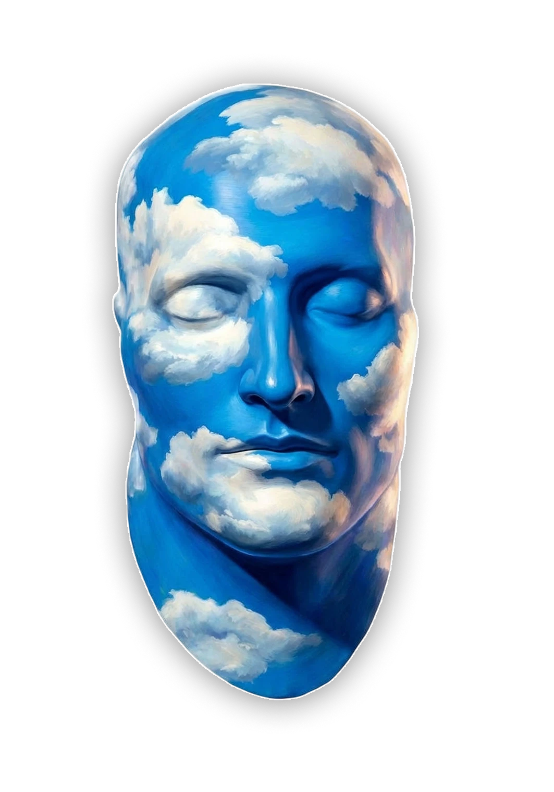

# 2894_ Head Follow

La cabeza de marca sigue al puntero con parallax 2.5D (WebGL). Cada píxel visible sale del PNG original; el mapa de profundidad solo decide cuánto se desplaza.

## Integrar en la web de 2894

Copiar `head-follow.js` y `assets/` y poner:

```html
<div data-head-follow data-depth="assets/head-depth.png" style="width:420px">
  
</div>
<script src="head-follow.js" defer></script>
```

- Ajustes: `HeadFollow.mount(el, { strength, smoothing, pivot, idle })`, o en vivo con `el.headFollow.setOptions({...})`.
- Sin WebGL o con `prefers-reduced-motion` queda el `` estático.
- Si cambia el arte, regenerar la profundidad con `scripts/head-depth/make_depth.py`.
